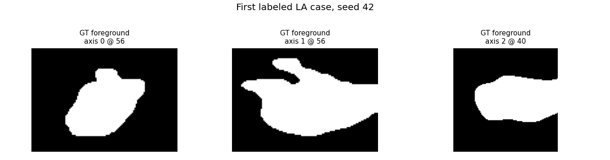
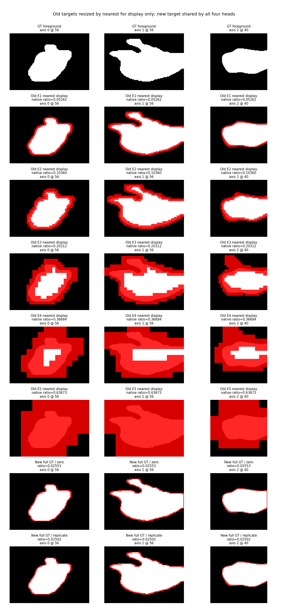
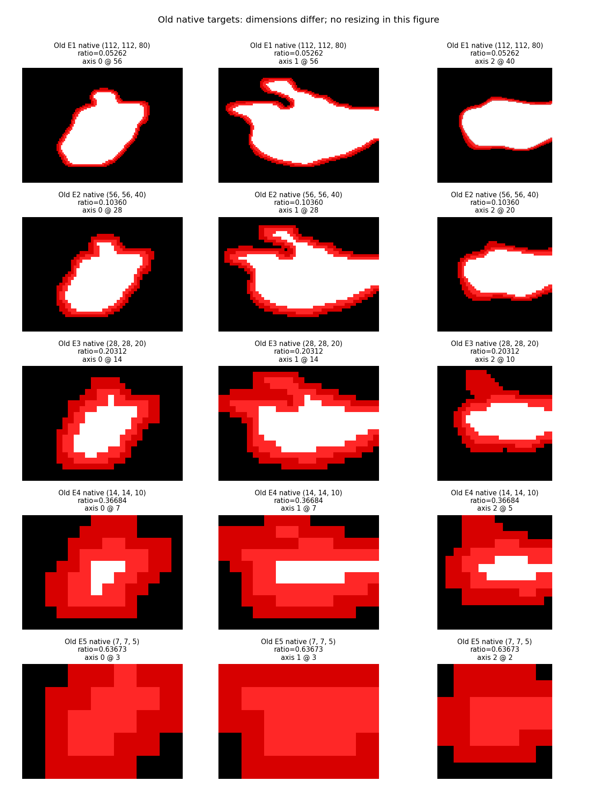
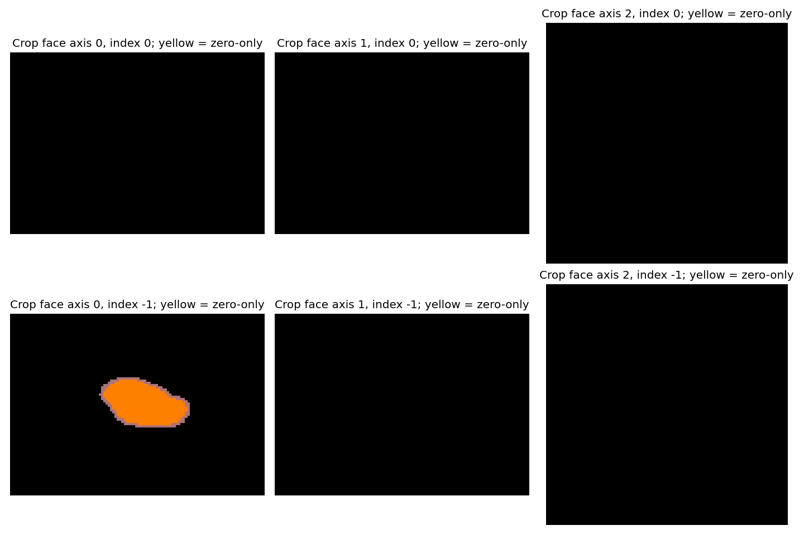

# Fixed LA boundary label audit

Only the first eight labeled cases from original train.list, two deterministic original-loader crops each.
Fixed example: first train case, seed 42, 112×112×80. Existing RandomRotFlip and RandomCrop are reused.

| Target | Native size | Mean boundary ratio | Min | Max |
|---|---|---:|---:|---:|
| old_morphology / 1 | [112, 112, 80] | 0.051220 | 0.032844 | 0.066712 |
| old_morphology / 2 | [56, 56, 40] | 0.101126 | 0.065832 | 0.131425 |
| old_morphology / 3 | [28, 28, 20] | 0.193284 | 0.131952 | 0.248214 |
| old_morphology / 4 | [14, 14, 10] | 0.350542 | 0.260204 | 0.436224 |
| old_morphology / 5 | [7, 7, 5] | 0.561735 | 0.379592 | 0.775510 |
| new_bfa_zero / shared_E1_E4 | [112, 112, 80] | 0.025967 | 0.017279 | 0.033776 |
| new_bfa_replicate / shared_E1_E4 | [112, 112, 80] | 0.024621 | 0.015568 | 0.032465 |

All padding assertions passed: differences confined to crop faces, replicate boundary is a subset of zero boundary, and both mark foreground only.
Zero/replicate differences across sixteen patches: 21612 voxels.

The red overlays show target boundaries. Yellow crop-face voxels are present only with zero padding.
Old targets in the aligned figure are enlarged by nearest only for display. A2/B2 upsample logits to one shared GT target.
No training, validation selection, hyperparameter search or modification to the data list was performed.
